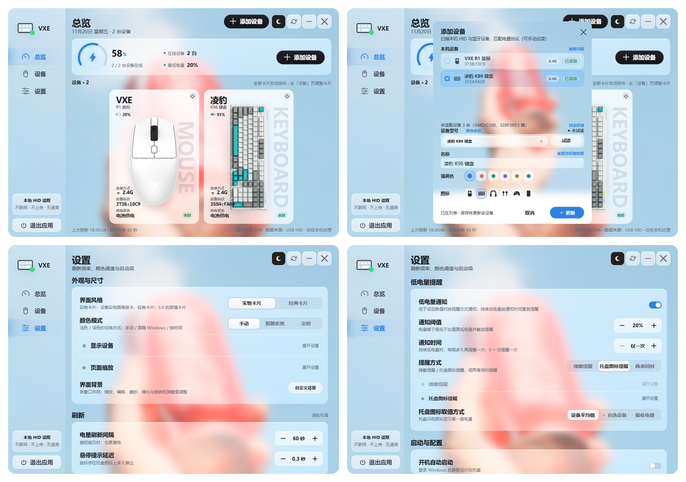

<h1 align="center"> VXE</h1>

  查看 Windows 已连接设备电量的托盘工具，支持无线鼠标、键盘、耳机与手柄。 
  通过 HID 2.4G、蓝牙系统属性与 XInput 读取，所有解析在本机完成，不联网、无遥测。

  

主面板汇总设备电量与连接状态，卡片自动适配一屏；也可通过托盘悬停和预览小窗快速查看。

资源占用（3.3.0，Windows 10、空设备配置短测；VXE 与 WebView2 完整进程树的 Private Bytes 均值）：主面板打开约 **231 MiB**，主面板与预览小窗同时打开约 **255 MiB**；隐藏约 5 秒后回收 WebView，托盘空闲约 **6.6 MiB**。实际占用会随设备数、图片、缩放及 WebView2 版本变化。

---

  

原背景

  

自定义背景

## 主要功能

  

| 模块 | 说明 |
|---|---|
| 托盘常驻 | 托盘图标按电量在绿 / 黄 / 红三档间取色，每 5% 填充一级，取值口径可选平均值 / 指定设备 / 最低电量；样式可选闪电 / 圆环 / 电池，低电量时按当前样式红色闪烁，没有可读设备时显示蓝色满格 |
| 三种查看方式 | 托盘悬停卡、左键预览小窗（最多 3 台）、主面板总览（卡片自动排进一屏） |
| 设备管理 | 手动扫描添加、协议与型号选择、接收器实例绑定、试读验证、命名 / 配色 / 图标、拖拽排序、重复添加拦截；出厂设备列表为空 |
| 协议库 | 内置 98 条厂商协议、48 个品牌分组、253 个唯一 VID:PID；支持外置 JSON 覆盖与未知 HID 自动探测 |
| 低电量提醒 | 约 6 秒成就式弹窗 + 提示音，或托盘图标红色闪烁，或两者同时；可设重复提醒间隔 |
| 界面与主题 | 实物照片 / 经典玻璃两种卡片；图片大小、位置、旋转及显示字段可调；自定义背景支持缩放、偏移、磨砂、暗化与旋转；浅色 / 深色、跟随系统或定时切换 |
| 便携与隐私 | 单文件便携 exe，首次运行在 exe 同级生成空设备配置；配置、图片、缓存均跟随 exe，数据不出本机 |
| 按需加载 | 托盘空闲不保留 WebView；窗口按需创建，隐藏约 5 秒后释放；预览小窗与悬停卡共用一个 WebView |

其他细节：开机自启、全局快捷键、电量刷新间隔可调、各窗口独立缩放；设置页可打开配置目录或恢复默认设置（设备列表保留）。

  

托盘图标可选闪电 / 圆环 / 电池三种样式，按电量在红 / 黄 / 绿三档间变色并按 5% 填充；无读数时显示蓝色满格，低电量时按当前样式红色闪烁。

## 支持设备（持续更新）

<b>展开查看支持的品牌与型号</b>

电量来源分三类：

1. **HID 2.4G 厂商协议**：内置 98 条协议（3.2.x 基线 57 条 + 3.3.0 扩充 41 条），覆盖鼠标、键盘、耳机与手柄接收器。
2. **蓝牙系统电量**：Windows 能为已配对蓝牙设备提供电量属性时直接读取，无需厂商协议。
3. **XInput 手柄**：最多 4 个槽位，原生四档电量映射为 5 / 20 / 50 / 100%。

### 3.3.0 扩充
3.3.0 新增 A 类型号（ATK F1 Ultimate / A9 Ultimate / Zero、VXE MAD R / MAD R Major Plus、VGN F1/F2 变体、MCHOSE G87 V2 / V9 Turbo / X9 / V9 Pro 2 / R9、ROG Delta II 等）与 B 类单帧/被动设备（SteelSeries Arctis、NZXT、WLmouse、Glorious、Zowie EC-CW、Cooler Master、LAMZU、Razer 耳机、G-Wolves、Ninjutso、Flydigi、Keychron、Rongyuan 键盘槽、Astro、Sony INZONE H5、Kysona、AJAZZ AK870、AULA L9/G9、Rapoo MT560/VT、MCHOSE L7、HyperX CF2、ROG Cetra 等）。缺少可靠帧/偏移的族继续 deferred。

### 内置协议覆盖

| 品牌 | 设备型号 | 通信方式 |
|---|---|---|
| 艾泰克 ATK | A87 Pro 键盘 V75X 有线键盘 Z87 系列键盘 A9 Air 大师+ 鼠标 A9 Ultimate 鼠标 F1 Pro Max 鼠标 F1 Ultimate 鼠标 F1 V3 鼠标 N9V2 ULTIMATE 耳机 | HID 写读 |
| 艾泰克 ATK / 威界 VXE | 威界 VXE MAD R 鼠标 威界 VXE MAD R Major Plus 鼠标 Zero 鼠标 | HID 写读 |
| 奥丁（俗称）Glorious | Model O/D 无线鼠标 | HID Feature |
| 北通 BEITONG | KP40D 手柄 | HID 写读 |
| 寸渊影弑 DARKRIM | SHADOW 耳机 | HID 写读 |
| 达尔优 DAREU | A950 AIR V2 鼠标 | HID 写读 |
| 多彩 DELUX | GH8K / M900 Ultra 2.4G 鼠标 | HID 写读 |
| 多彩 / 英菲克 | 2.4G 鼠标 | 被动监听 |
| 恩杰 NZXT | Lift Elite 无线鼠标 | HID 写读 |
| 飞智 Flydigi | 新架构手柄 APEX5 手柄 Vader 4 Pro 手柄 | HID 写读 |
| 高斯 GANSS | GS3104T-Pro 键盘 | HID 写读 |
| 黑爵 AJAZZ | AK870 键盘 | HID Feature |
| 华硕 ROG | Omni AZOTH 系列键盘 HARPE 鼠标 KERIS 鼠标 Keris AimPoint 等直连鼠标 SPEEDNOVA 8K 鼠标 Cetra SpeedNova 耳机 PELTA / DELTA II 耳机 | HID 控制输出（IOCTL）；HID 写读 |
| 极度未知 HyperX | Pulsefire Haste 2 无线鼠标 Cloud Alpha 2 耳机 Cloud Alpha Wireless 耳机 Cloud Flight 2 耳机 Cloud II Core Wireless 耳机 Cloud II Wireless 耳机 Cloud III S 耳机 Cloud III Wireless 耳机 | HID 写读；被动监听 |
| 渴创 Keychron | 8K 接收器鼠标 M1/M2/M3/M6/M7 鼠标 M4 鼠标 | HID Feature；HID 写读 |
| 酷冷至尊 Cooler Master | MM712 鼠标 | HID 写读 |
| 莱奥伯格 LEOBOG | Hi75c Pro 键盘 HI98PRO 键盘 | HID 写读 |
| 狼蛛 AULA | F108 Pro 键盘 F99 Pro 键盘 L9 Ultra 鼠标 G9 耳机 | HID 写读；被动监听 |
| 兰族 LAMZU | Maya X 鼠标 | HID Feature |
| 雷柏 Rapoo | MT560 鼠标 VT 系列鼠标 | 被动监听 |
| 雷蛇 Razer | BlackShark V2 Pro 2023 耳机 | HID 写读 |
| 凌豹 Lingbao | K98 键盘 M1 Pro 鼠标 M5PRO Max 鼠标 | HID 写读；HID Feature（只读）；HID Feature |
| 迈丛 MCHOSE | 41E4 键盘接收器 G75 键盘 G75 Pro 键盘 G87 V2 键盘 GX87 键盘 K99 键盘 Z75S 键盘 A7 V3 Pro 鼠标 A7 V3 Ultra+ 鼠标 G7 鼠标 L7 Pro 鼠标 R9 耳机 V9 Pro 2 耳机 V9 Turbo 耳机 V9 Turbo+ 耳机 X9 耳机 | HID 写读；被动监听 |
| 漫步者 HECATE | G3M Pro 鼠标 G5M Pro 鼠标 | HID 写读 |
| 魅谷 IMECOO | P1 鼠标 | HID 写读 |
| 派世 Pulsar | Link 8K 鼠标 X2 鼠标 | HID 写读 |
| 前行者 EWEADN | S9 鼠标 S9 PRO 8K 鼠标 | HID Feature；HID 写读 |
| 容源 Rongyuan | 2.4G 键盘接收器 | HID Feature |
| 赛洛斯 Scyrox | 8K 鼠标 | HID 写读 |
| 赛睿 SteelSeries | Arctis 1 耳机 Arctis 7 耳机 Arctis 7+ 耳机 Arctis Nova 5 耳机 Arctis Nova 7 耳机 Arctis Nova Pro Wireless 耳机 | HID 写读 |
| 水月雨 MOONDROP | GM01 Pro 耳机 | HID 写读 |
| 索尼 Sony | INZONE H5 耳机 | HID 写读 |
| 钛度 TAIDU | HJSDZHI S1-V2 鼠标 TSG809 鼠标 | HID 写读 |
| 万灵竞记 WLmouse | Beast X 鼠标 | HID Feature |
| 威界 VXE | R1 鼠标 R1 Pro Max 鼠标 R1 SE+ 鼠标 V3 NK 鼠标 | HID 写读 |
| 西伯利亚 XIBERIA | T7 / T7 GT 耳机 | HID 写读 |
| 樱桃 CHERRY | MX 2.0S WL Pro 键盘 | HID 写读 |
| 卓威 Zowie | EC-CW 鼠标 | HID 写读 |
| 游狼 G-Wolves | 旧协议无线鼠标 新协议无线鼠标 | HID Feature |
| ASTRO | A50 Gen 5 耳机 | HID 写读 |
| CROCIRIS | X7 8K 鼠标 | HID 写读 |
| Hitscan | Hyperlight 鼠标 | HID 写读 |
| Kysona | M600 鼠标 | HID 写读 |
| Ninjutso | Sora V2 鼠标 | HID Feature |
| VAXEE | ZYGEN 鼠标 | HID 写读 |
| VGN | 北影 2.4G 键盘 V98 Pro 键盘 蜻蜓 3 Pro Max 鼠标 蜻蜓 3 Ultra 鼠标 蜻蜓 Dragonfly3 SE 鼠标 蜻蜓 F1 Moba 鼠标 蜻蜓 F1 Pro 4K 鼠标 蜻蜓 F1 Pro 有线鼠标 蜻蜓 F1 V5 Turbo+ 鼠标 蜻蜓 F2 大师+ 鼠标 蜻蜓 F2 Pro Max 鼠标 F1 V2 Pro Max 鼠标 F1 V5 Ultra 鼠标 F2 V2 Ultra 鼠标 Y2 V2 Pro Max 鼠标 | HID 写读；HID Feature |
| WOB | Rainy 75 键盘 | HID 写读 |
| Zaopin | Z2 Mini 鼠标 | HID 写读 |

部分键盘与鼠标共用公版接收器 VID/PID，软件会先读取会话 ACK 型号码，再选择对应协议。扫描不到时可使用「自动探测」逐个尝试协议模板，命中后生成外置协议 JSON。

## 项目参考

| 项目 | 参考内容 |
|---|---|
| [atk-battery-tray](https://github.com/su1073033508-ops/atk-battery-tray) | 项目灵感来源：托盘常驻、快速查看无线设备电量的产品方向 |
| [XBatteryStatus](https://github.com/JinShichang/XBatteryStatus) | 低电量通知参考：提醒弹窗的出现时机、视觉层次与电量呈现方式 |
