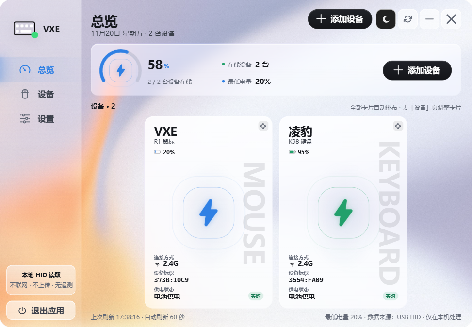
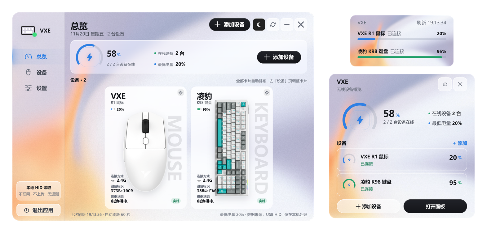
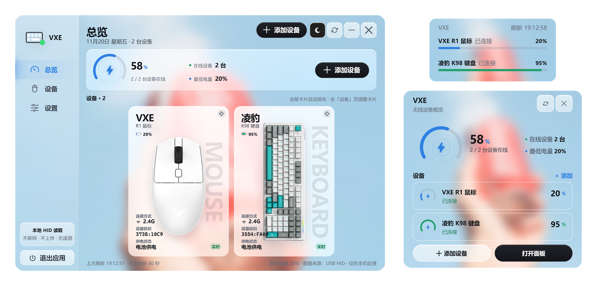
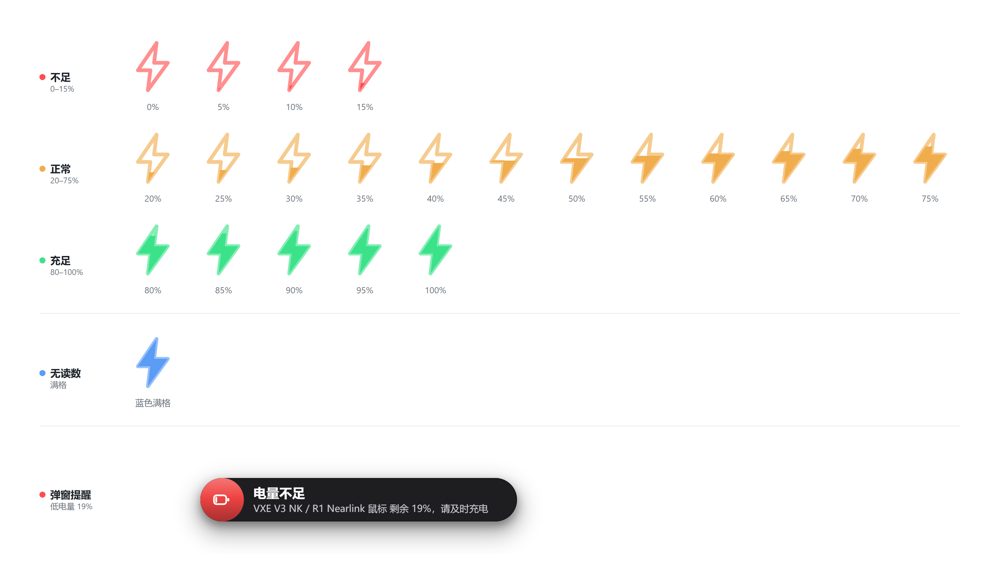

<h1 align="center"> VXE</h1>

  查看 Windows 已连接设备电量的托盘工具，支持无线鼠标、键盘、耳机与手柄。 
  通过 HID 2.4G、蓝牙系统属性与 XInput 读取，所有解析在本机完成，不联网、无遥测。

  

主面板显示综合电量、在线设备数量与最低电量；每张卡片对应一台设备，标注连接方式、设备标识与供电状态。总览页会把设备卡自动排进一屏，设备少时放大、多时缩小；尚未添加设备时显示「待添加」占位卡。

---

  

原背景

  

自定义背景

## 主要功能

  

| 模块 | 说明 |
|---|---|
| 托盘常驻 | 闪电图标按电量在绿 / 黄 / 红三档间取色，每 5% 填充一级，取值口径可选平均值 / 指定设备 / 最低电量；低电量时红色闪烁，没有可读设备时显示蓝色满格闪电 |
| 三种查看方式 | 托盘悬停卡、左键预览小窗（最多 3 台）、主面板总览（卡片自动排进一屏） |
| 设备管理 | 扫描添加、协议自动匹配、共用接收器型号选择、试读验证、命名 / 配色 / 图标、拖拽排序、重复添加拦截；空列表显示待添加占位卡 |
| 协议库 | 内置 54 条厂商协议、27 个品牌分组；支持外置 JSON 覆盖与未知 HID 自动探测 |
| 低电量提醒 | 约 6 秒成就式弹窗 + 提示音，或托盘红色闪电闪烁，或两者同时；可设重复提醒间隔 |
| 界面与主题 | 实物照片卡片 / 经典玻璃卡片；每台设备可换图并调整大小与位置；支持自定义背景（缩放、偏移、磨砂、暗化、旋转）；浅色 / 深色主题 |
| 便携与隐私 | 单文件便携 exe，首次运行在 exe 同级生成 `config.json`；数据不出本机 |

其他细节：开机自启、全局快捷键、电量刷新间隔可调、各窗口独立缩放；设置页可打开配置目录或恢复默认设置（设备列表保留）。

  

托盘闪电图标按电量在红 / 黄 / 绿三档间变色并按 5% 填充；无读数时显示蓝色满格，低电量时弹出提醒（设置可选）。

## 支持设备（持续更新）

<b>展开查看支持的品牌与型号</b>

电量来源分三类：

1. **HID 2.4G 厂商协议**：内置 54 条协议，覆盖鼠标、键盘、耳机与手柄接收器。
2. **蓝牙系统电量**：Windows 能为已配对蓝牙设备提供电量属性时直接读取，无需厂商协议。
3. **XInput 手柄**：最多 4 个槽位，原生四档电量映射为 5 / 20 / 50 / 100%。

### 内置协议覆盖

| 品牌 | 支持型号 |
|---|---|
| VXE | V3 NK / R1 Nearlink、R1 Pro Max / R1 SE |
| ATK | F1 Pro Max / F1 V3 / F1 Ultimate、A9 Air 大师+、Z87 系键盘、N9V2 Ultimate 耳机、V75X（有线）、Nordic 54 通用鼠标 |
| ATK / VXE | 373B 其他型号鼠标（自动识别） |
| VAXEE | VAXEE / ZYGEN 无线鼠标（3057 族） |
| 华硕 ROG | PELTA / DELTA II 耳机、AZOTH 系 Omni 键盘、HARPE / KERIS Omni 鼠标、Keris AimPoint 等直连鼠标、SPEEDNOVA 8K（Harpe II Ace 等） |
| HyperX | Cloud II Wireless、Cloud III / II Core Wireless、Alpha 2、Alpha Wireless |
| 迈丛 MCHOSE | G75 Pro / Z75S / K99 / GX87 / G75 键盘、A7 V3 Pro / Ultra+、G7、V9 Turbo+ 耳机 |
| 凌豹 Lingbao | K98 键盘、M1 Pro、M5PRO Max |
| 狼蛛 AULA | F99 Pro、F108 Pro |
| LEOBOG | Hi75c Pro / HI98PRO |
| VGN | 北影 2.4G 键盘、蜻蜓 Dragonfly3 SE、F1 Pro（4K 接收器）、F2 大师+、F1 V5 Turbo+、F1 Moba F503、ryMs 接收器（3 Pro Max / Y2 V2 Pro Max / F1 V2 Pro Max / 3 Ultra / F1 V5 Ultra / F2 V2 Ultra）、V98 Pro |
| 钛度 TAIDU | TSG809 / HJSDZHI S1-V2 |
| IMECOO | P1 |
| 达尔优 DAREU | A950 AIR V2 |
| CROCIRIS | X7 Receiver 8K |
| 西伯利亚 XIBERIA | T7 / T7 GT |
| Pulsar 派世 | X2 系 / Link 8K |
| Scyrox | 8K |
| Hitscan | Hyperlight |
| HECATE 漫步者 | G3M Pro、G5M Pro |
| CHERRY | MX 2.0S WL Pro |
| 水月雨 MOONDROP | GM01 Pro |
| 高斯 GANSS | GS3104T-Pro |
| 寸渊影弑 DARKRIM | SHADOW |
| 前行者 EWEADN | S9 PRO 8K |
| 多彩 DELUX | GH8K / M900 Ultra |
| 北通 BEITONG | KP40D |

部分键盘与鼠标共用公版接收器 VID/PID，软件会先读取会话 ACK 型号码，再选择对应协议。扫描不到时可使用「自动探测」逐个尝试协议模板，命中后生成外置协议 JSON。

**暂不支持**：罗技 HID++、雷蛇、SteelSeries、Corsair 等多步协商协议，以及雷柏 VT3S、DualSense 等纯被动上报设备。可先尝试自动探测，或通过 exe 同级的 `device_profiles/*.json` 补充外置协议。

## 项目参考

| 项目 | 参考内容 |
|---|---|
| [atk-battery-tray](https://github.com/su1073033508-ops/atk-battery-tray) | 项目灵感来源：托盘常驻、快速查看无线设备电量的产品方向 |
| [XBatteryStatus](https://github.com/JinShichang/XBatteryStatus) | 低电量通知参考：提醒弹窗的出现时机、视觉层次与电量呈现方式 |
